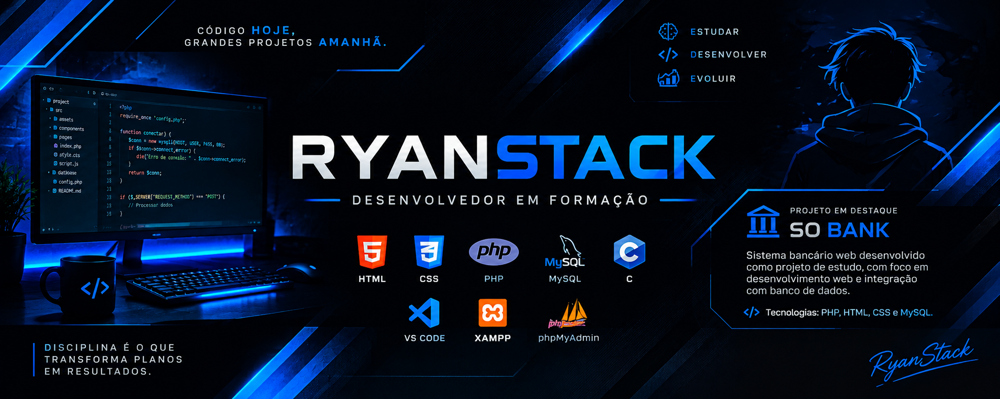

  

  # 💙 RYANSTACK

  ### Desenvolvedor em formação | Estudante de TI 💻

  *Estudando, desenvolvendo e evoluindo a cada linha de código.*

---

## 👨‍💻 Sobre mim

Olá! Sou estudante do curso Técnico em Informática integrado ao Ensino Médio e tenho interesse em desenvolvimento de software e tecnologia.

- 🎓 Técnico em Informática integrado ao Ensino Médio.
- 💻 Conhecimentos em HTML, CSS, PHP, SQL e C.
- 🗄️ Experiência acadêmica com MySQL e phpMyAdmin.
- 🛠️ Utilizo VS Code e XAMPP.
- 🏦 Desenvolvendo o projeto SO BANK.
- 📚 Sempre buscando aprender e aprimorar minhas habilidades.

## 🛠️ Tecnologias

  
  &nbsp;
  
  &nbsp;
  
  &nbsp;
  
  &nbsp;
  
  &nbsp;
  

| Tecnologia | Nível |
|---|---|
| HTML | Intermediário |
| CSS | Intermediário |
| PHP | Intermediário |
| SQL | Intermediário |
| C | Intermediário |
| MySQL | Banco de dados |

## 🔧 Ferramentas

- Visual Studio Code
- XAMPP
- MySQL
- phpMyAdmin

## 📂 Projeto em destaque

### 🏦 SO BANK

Sistema bancário web desenvolvido como projeto de estudo, com foco na prática de desenvolvimento web e integração com banco de dados.

**Tecnologias utilizadas:** PHP, HTML, CSS e MySQL.

## 🎯 Objetivos

- Aprimorar meus conhecimentos em programação.
- Desenvolver projetos cada vez mais completos.
- Revisar e aprender novas linguagens.
- Construir meu portfólio profissional na área de TI.

---

  <h3>💙 Obrigado por visitar meu perfil!</h3>
  <i>Transformando conhecimento em código.</i>

## 📊 Estatísticas do GitHub

  

